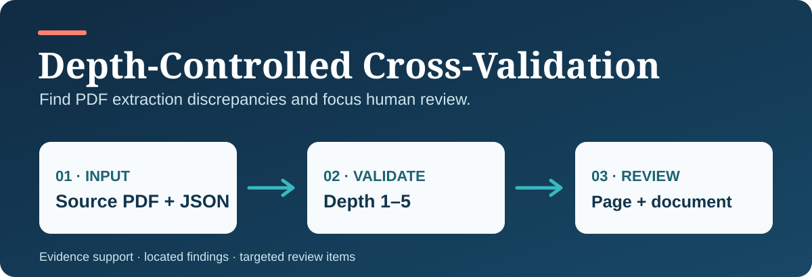
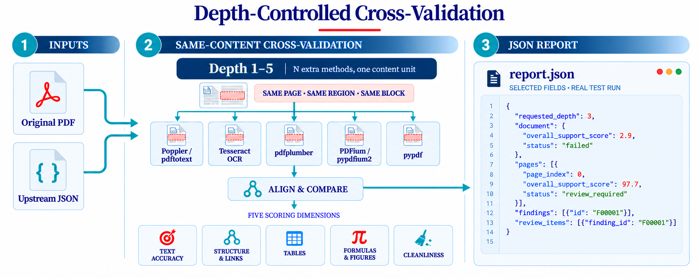

<p align="center">
  <a href="README.md"></a>
  <a href="README.zh-CN.md"></a>
</p>

<p align="center"></p>

# Depth-Controlled Cross-Validation

For teams receiving a PDF and its page-level extraction JSON, this local CLI compares the extracted content with the source through configurable reading methods. It returns per-page and document-level evidence support scores, located discrepancies, and a focused review list.

**Current stage:** runnable prototype. The included sample and 25 synthetic behavior tests exercise the local workflow. Accuracy on real business documents and the reduction in human review time have not been measured.

## Next-version Depth 5

The owner has defined **Depth 5 as LLM fine-grained review** of the source image, candidate extraction and existing discrepancies. Depths 1–4 remain local checks. **The model adapter is not connected yet**; the current v0.1 CLI below still uses legacy local-reader counting. See the [accepted design and evidence contract](project-support/depth-5-model-review.md) and [current state](PROJECT_STATE.md).

## Try the included example

Requires Python 3.12+, [uv](https://docs.astral.sh/uv/), [Poppler's `pdftotext`](https://poppler.freedesktop.org/), and [Tesseract OCR](https://github.com/tesseract-ocr/tesseract) with English language data. Check that `pdftotext` and `tesseract` are on your `PATH`.

```bash
uv sync --extra test
uv run python -m pdf_validator \
  --pdf examples/sample.pdf \
  --json examples/sample.json \
  --depth 3 \
  --output sample.report.json
```

The bundled PDF and JSON are **synthetic**. On the tested macOS setup this command prints `pass: 100.0 / 100; 0 findings` and writes `sample.report.json` plus `sample.report.md`. This is a smoke test of the workflow, not an accuracy benchmark. Run the behavior checks with:

```bash
uv run --extra test python -m unittest discover -s tests -v
```

For your own document, replace the two paths with its original PDF and page-ordered upstream JSON. The [sample input](examples/sample.json) shows the current internal schema: zero-based physical `page_index`, stable block IDs, block type and text, and optional page-relative `bbox` coordinates in PDF points from the top-left. `parser_engines` can identify upstream readers so the validator records overlapping evidence.

## What the report gives you

| Output | What to inspect |
| --- | --- |
| `document` | Overall evidence support score, five dimension scores, status, and pages needing review |
| `pages[]` | Per-page scores, methods actually used, status, and finding IDs |
| `findings[]` | Discrepancy type and severity, PDF page and location, upstream IDs, and supporting evidence |
| `review_items[]` | Located items to send to a human reviewer |

The five dimensions are **text accuracy**, **structure and links**, **tables**, **formulas and figures**, and **cleanliness**. Checks run in both directions: missing PDF content in JSON and unsupported or misclassified JSON content against the PDF. A `pass` means the available checks found no issue in that run. `overall_support_score` measures support from those checks; it is not a probability that the extraction is correct. `calibrated_correctness` remains `null` until independently labeled data is available.

`Depth=1..5` requests that many *additional* reading methods for the same source content: Poppler/`pdftotext`, Tesseract OCR, `pdfplumber`, PDFium/`pypdfium2`, and `pypdf`. The validator skips a known identical upstream reader and records evidence families so shared PDF text-layer errors are not counted as independent agreement. Currently `pages[].effective_depth` counts usable methods at **page level**. PDFium and `pypdf` do not yet supply comparable region-level output, so per-block Depth 4–5 remains a target rather than a validated behavior.

<a href="assets/overview.png"></a>

*Click the diagram for full resolution. It illustrates the target per-block workflow; the current page-level Depth limit is described above.*

## When it is useful

| Situation | Input change | Expected evidence |
| --- | --- | --- |
| A number or negation was read incorrectly | Change `10 mg` to `100 mg` in a JSON paragraph | A located `critical_text_difference` finding |
| A table cell moved or changed | Change a cell value and its row/column box | `cell_content_difference` and/or `cell_row_column_conflict` |
| A page or body boundary was lost | Omit a PDF page or put its page number in body text | `missing_pdf_page_in_json` or `page_number_in_body` |

These cases are covered by the synthetic tests. A completed CLI run returns exit code 0 even when the report status is `failed`; read `document.status` for quality routing. Invalid input returns exit code 2.

## Compatibility and fit

| Environment | Status |
| --- | --- |
| macOS, Python 3.12, Poppler, Tesseract | Tested locally with the bundled example and synthetic behavior tests |
| Linux and Windows | Not tested in this release |
| Company-specific upstream JSON | Adapter not included; map it to the documented internal schema |

Use this when a PDF extraction pipeline needs evidence-backed quality triage and page-level review locations. It is not a ground-truth benchmark, an extraction replacement, or a certified correctness decision. Formula meaning, vector-graphic meaning, complex merged tables, and correlated reader errors need additional evidence. The validator itself runs locally and does not send the PDF to a remote model.

## References and license

The implementation uses [Poppler](https://poppler.freedesktop.org/) for text extraction, [Tesseract](https://github.com/tesseract-ocr/tesseract) for visual OCR, and the Python libraries [pdfplumber](https://github.com/jsvine/pdfplumber), [pypdfium2](https://github.com/pypdfium2-team/pypdfium2), and [pypdf](https://pypdf.readthedocs.io/) for additional PDF observations. These are dependencies, not endorsements; each retains its own license.

Repository-authored code, documentation, and diagrams are [MIT licensed](LICENSE), © 2026 Jay Tang. The included example PDF/JSON is synthetic. Issues and pull requests are welcome, especially with reproducible PDF/JSON cases that can be shared legally.
