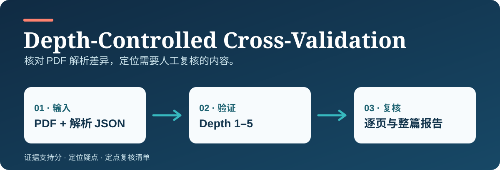
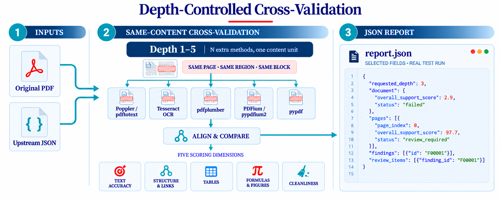

<p align="center">
  <a href="README.md"></a>
  <a href="README.zh-CN.md"></a>
</p>

<p align="center"></p>

# Depth-Controlled Cross-Validation

面向接收原始 PDF 与逐页解析 JSON 的团队，这个本地命令行程序用可配置的读取方法核对解析内容与原文，输出逐页及整篇的证据支持分、可定位的差异和定点复核清单。

**当前阶段：**本地原型可运行。随附示例和 25 项合成样本行为测试覆盖了本地工作流；真实业务文档的准确性与节省人工复核时间的效果尚未测量。

## 运行随附示例

需要 Python 3.12+、[uv](https://docs.astral.sh/uv/)、[Poppler 的 `pdftotext`](https://poppler.freedesktop.org/) 和带英语语言数据的 [Tesseract OCR](https://github.com/tesseract-ocr/tesseract)。先确认 `pdftotext` 和 `tesseract` 位于 `PATH`。

```bash
uv sync --extra test
uv run python -m pdf_validator \
  --pdf examples/sample.pdf \
  --json examples/sample.json \
  --depth 3 \
  --output sample.report.json
```

随附 PDF 与 JSON 均为**合成样本**。在已测试的 macOS 环境中，命令输出 `pass: 100.0 / 100; 0 findings`，并生成 `sample.report.json` 和 `sample.report.md`。这只验证工作流可以运行，不是解析准确率 benchmark。行为测试命令：

```bash
uv run --extra test python -m unittest discover -s tests -v
```

使用自己的文档时，将两个输入路径替换为原始 PDF 和逐页上游 JSON。[样例输入](examples/sample.json)展示当前内部格式：从零开始的物理页索引 `page_index`、稳定的内容块 ID、类型与文本，以及可选的页内 `bbox`。坐标单位是 PDF point，原点在左上角。可选字段 `parser_engines` 用于识别上游读取器并标记重叠证据。

## 报告包含什么

| 输出 | 查看重点 |
| --- | --- |
| `document` | 整篇证据支持分、五维分数、状态及待复核页 |
| `pages[]` | 逐页分数、实际使用的方法、状态及问题 ID |
| `findings[]` | 差异类型和严重度、PDF 页码与位置、上游条目 ID、支持证据 |
| `review_items[]` | 交给人工处理的定点条目 |

五个维度是**信息准确性**、**结构与关联**、**表格**、**公式与图形**、**除杂率**。程序双向检查 PDF 中遗漏到 JSON 的内容，以及 JSON 中无法从 PDF 支持或分类错误的内容。`pass` 表示本次可用检查未发现问题。`overall_support_score` 是检查证据的支持分，不是解析正确的概率；在获得独立人工标注数据之前，`calibrated_correctness` 保持 `null`。

`Depth=1..5` 表示为同一源内容请求这么多种*额外*读取方法：Poppler/`pdftotext`、Tesseract OCR、`pdfplumber`、PDFium/`pypdfium2`、`pypdf`。程序跳过已知与上游相同的方法，并记录证据家族，避免把同一 PDF 文字层造成的共同错误当成独立一致。目前 `pages[].effective_depth` 只统计**页级**可用方法数；PDFium 和 `pypdf` 尚未提供可对齐的区域级输出，逐内容块的 Depth 4–5 仍是目标行为，尚未完成验证。

<a href="assets/overview.png"></a>

*点击查看原尺寸。图展示逐块验证的目标工作流；当前页级 Depth 边界以上文为准。*

## 适用场景

| 场景 | 输入变化 | 应看到的证据 |
| --- | --- | --- |
| 数字或否定词识别错误 | 将 JSON 段落中的 `10 mg` 改成 `100 mg` | 可定位的 `critical_text_difference` |
| 表格单元格错位或内容变化 | 修改单元格值及其行列位置框 | `cell_content_difference` 和/或 `cell_row_column_conflict` |
| 缺页或正文边界污染 | 漏掉 PDF 页，或把页码放入正文 | `missing_pdf_page_in_json` 或 `page_number_in_body` |

合成测试覆盖上述情况。命令行检查正常完成时，即使报告状态为 `failed`，进程退出码仍为 0；质量分流应读取 `document.status`。输入无效时退出码为 2。

## 兼容性与适用边界

| 环境 | 状态 |
| --- | --- |
| macOS、Python 3.12、Poppler、Tesseract | 已在本机通过随附示例与合成行为测试 |
| Linux 与 Windows | 本版未验证 |
| 公司特定的上游 JSON | 尚无适配器，需转换到文档中的内部格式 |

适合需要按证据排查 PDF 解析质量、定位待复核页面的流水线。它不是人工真值 benchmark、替代解析器或已认证的正确性判断。公式语义、矢量图语义、复杂合并表格以及多个读取器的共同错误仍需要额外证据。验证程序在本机运行，本身不会把 PDF 发送到远程模型。

## 参考与许可

程序使用 [Poppler](https://poppler.freedesktop.org/) 提取文字、[Tesseract](https://github.com/tesseract-ocr/tesseract) 做视觉 OCR，并使用 [pdfplumber](https://github.com/jsvine/pdfplumber)、[pypdfium2](https://github.com/pypdfium2-team/pypdfium2)、[pypdf](https://pypdf.readthedocs.io/) 获取其他 PDF 观察。这些是依赖，不表示它们为本项目背书；各自保留原有许可。

仓库原创代码、文档和图示采用 [MIT 许可](LICENSE)，© 2026 Jay Tang。随附 PDF/JSON 为合成样本。欢迎提交 issue 或 pull request，尤其是有权公开共享、可复现的问题样本。
